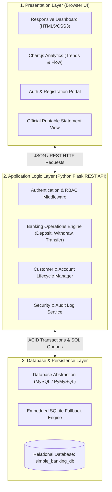
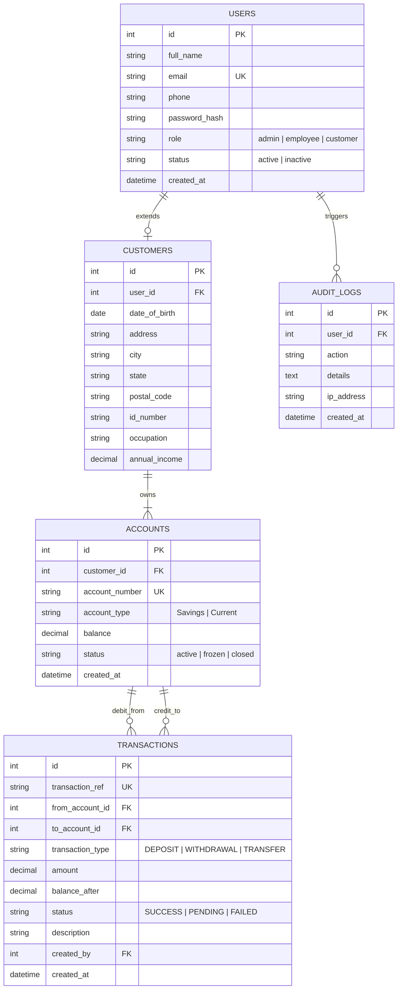
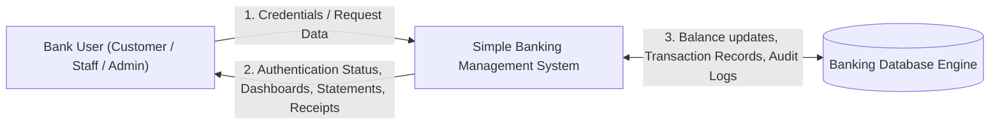
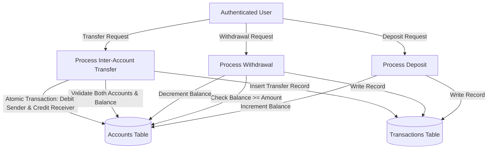

# B.Tech Software Engineering Project Report
# Simple Banking Management System

---

## 1. Project Title & Overview
- **Project Title:** Simple Banking Management System (Apex Horizon National Bank)
- **Academic Domain:** B.Tech Computer Science & Engineering / Information Technology
- **Subject:** Software Engineering & Database Management Systems
- **Architecture Model:** Three-Tier Architecture (Client-Side Presentation, Application Logic / REST API, Relational Database Layer)

---

## 2. Problem Statement & Objectives
Traditional legacy banking software often suffers from fragmented user experiences, unintuitive workflows, and lack of clear separation of concerns across user roles.

### Objectives:
1. Deliver a secure, responsive, role-based banking prototype supporting **Admin**, **Employee**, and **Customer** personas.
2. Implement core double-entry banking operations: **Cash Deposit**, **Cash Withdrawal**, and **Atomic Inter-Account Fund Transfer**.
3. Guarantee database integrity and ACID compliance (Atomicity, Consistency, Isolation, Durability) to eliminate race conditions and partial balance mutations.
4. Provide comprehensive auditing, telemetry dashboards, interactive Chart.js visualizations, and downloadable account statements.

---

## 3. System Architecture Diagram

---

## 4. Entity-Relationship (ER) Diagram

---

## 5. Data Flow Diagrams (DFD)

### Level 0 DFD (Context Diagram)

### Level 1 DFD (Banking Operations Breakdown)

---

## 6. Database Dictionary

| Table Name | Column | Type | Constraints | Description |
| :--- | :--- | :--- | :--- | :--- |
| `users` | `id` | INT / INTEGER | PK, AUTO_INCREMENT | Unique user identifier |
| `users` | `full_name` | VARCHAR(100) | NOT NULL | User's legal name |
| `users` | `email` | VARCHAR(120) | UNIQUE, NOT NULL | Login credential |
| `users` | `password_hash` | VARCHAR(255) | NOT NULL | Secure salted hash (pbkdf2:sha256) |
| `users` | `role` | VARCHAR(20) | ENUM('admin','employee','customer') | RBAC permission level |
| `customers` | `id` | INT / INTEGER | PK, AUTO_INCREMENT | Customer identity |
| `customers` | `user_id` | INT / INTEGER | FK -> users(id) | Associated user account |
| `customers` | `id_number` | VARCHAR(50) | NULL | National ID / Government proof |
| `accounts` | `id` | INT / INTEGER | PK, AUTO_INCREMENT | Account primary key |
| `accounts` | `customer_id` | INT / INTEGER | FK -> customers(id) | Account owner reference |
| `accounts` | `account_number` | VARCHAR(20) | UNIQUE, NOT NULL | 10-digit bank account number |
| `accounts` | `account_type` | VARCHAR(20) | Savings, Current | Retail product category |
| `accounts` | `balance` | DECIMAL(15,2) | NOT NULL, DEFAULT 0.00 | Real-time available ledger balance |
| `accounts` | `status` | VARCHAR(20) | active, frozen, closed | Operational state |
| `transactions` | `id` | INT / INTEGER | PK, AUTO_INCREMENT | Transaction row ID |
| `transactions` | `transaction_ref` | VARCHAR(30) | UNIQUE, NOT NULL | Unique reference code (e.g. TXN-...) |
| `transactions` | `transaction_type` | VARCHAR(20) | DEPOSIT, WITHDRAWAL, TRANSFER | Accounting operation type |
| `transactions` | `amount` | DECIMAL(15,2) | NOT NULL, > 0.00 | Monetary value |
| `transactions` | `balance_after` | DECIMAL(15,2) | NOT NULL | Resulting balance post-mutation |
| `audit_logs` | `id` | INT / INTEGER | PK, AUTO_INCREMENT | Audit log primary key |
| `audit_logs` | `action` | VARCHAR(100) | NOT NULL | Security / operational event name |

---

## 7. Security Architecture & Implementation

1. **Password Hashing**: Passwords are never stored in plaintext. Passwords are transformed using PBKDF2 with SHA-256 and cryptographic salts via `werkzeug.security`.
2. **Atomic Fund Transfers (ACID Compliance)**: Fund transfers update both sender and receiver accounts inside an isolated transaction block (`BEGIN ... COMMIT`). If an exception or database disconnect occurs, a complete `ROLLBACK` is issued to prevent money creation or destruction.
3. **Role-Based Access Control (RBAC)**: Enforced both on the client UI and verified strictly server-side using the `@role_required(['admin', 'employee'])` Python decorator.
4. **Input Sanitization & Validation**:
   - Negative amounts and zero transfers are rejected with HTTP 400.
   - Sender cannot transfer funds to their own account.
   - Withdrawals exceeding available balances are blocked before executing database writes.

---

## 8. Academic Viva & Review Questions

**Q1: How does the system handle atomicity during fund transfers?**  
*Answer:* The application wraps debit and credit database operations in a single atomic database transaction. If the receiver credit fails after the sender debit, the transaction context triggers a rollback, restoring the original balance without side-effects.

**Q2: What is the benefit of the dual MySQL/SQLite database manager?**  
*Answer:* In real-world software engineering, dependency on external services must not prevent evaluation or development. The database layer (`DatabaseManager`) seamlessly connects to MySQL if available, but falls back to SQLite transparently while using the exact same schema and SQL queries.

**Q3: How are passwords secured against rainbow table attacks?**  
*Answer:* Werkzeug's `generate_password_hash` applies PBKDF2 with HMAC-SHA256 and an automatically generated cryptographic salt, ensuring identical plaintext passwords produce distinct hashes.
